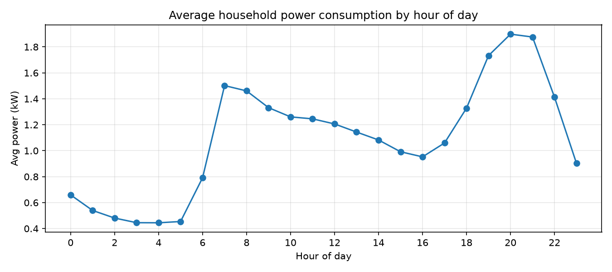
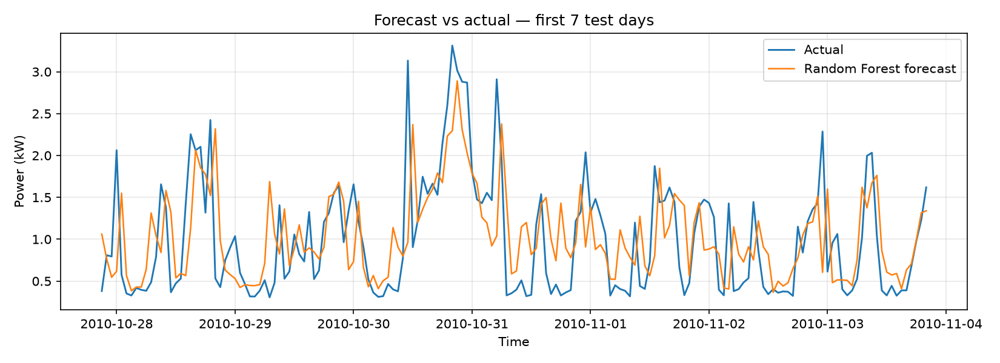
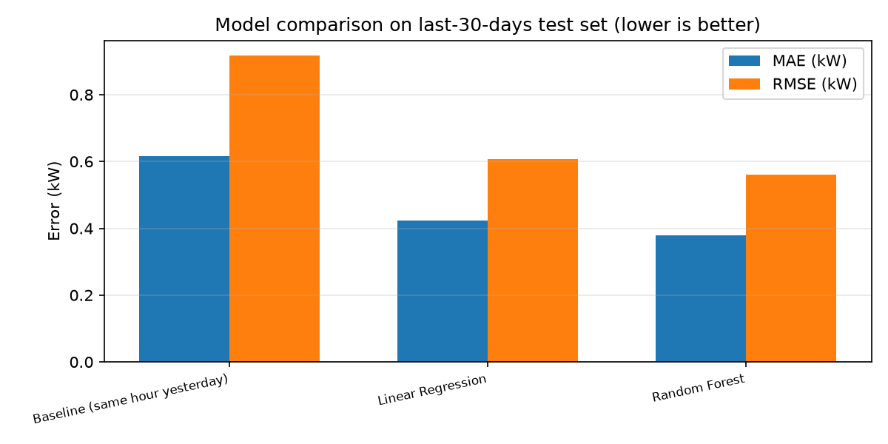

# Household Energy Consumption Forecasting with Machine Learning

Forecasting hourly household electricity consumption from real smart-meter data — the ML sequel to my earlier Bluetooth smart-meter hardware project: same problem (understanding household energy use), now solved with data and machine learning.

## What this does
- Loads ~2M minute-level smart-meter records (UCI *Individual Household Electric Power Consumption* dataset, one household, Dec 2006 – Nov 2010).
- Cleans the data (`?` missing values, timestamp parsing) and resamples to **34,211 hourly** average-power readings.
- Engineers calendar features (hour, day of week, month) and lag/rolling features (previous hour, same hour yesterday, same hour last week, 24h rolling mean).
- Trains three forecasters and evaluates them honestly on a **chronological** test split (the final 30 days):

| Model | MAE (kW) | RMSE (kW) |
|---|---|---|
| Baseline — "same hour yesterday" | 0.6150 | 0.9168 |
| Linear Regression | 0.4242 | 0.6074 |
| **Random Forest** | **0.3795** | **0.5599** |

The Random Forest cuts forecast error by **38.3%** versus the naive baseline.

## Figures
**Average consumption by hour of day** — clear morning/evening peaks, the pattern the lag features exploit:



**Forecast vs actual** — first 7 days of the test set:



**Model comparison** (lower is better):



## Run it
```bash
# 1. Get the data (free, UCI):
#    https://archive.ics.uci.edu/dataset/235/individual+household+electric+power+consumption
#    unzip household_power_consumption.txt next to this repo (see src/pipeline.py RAW path)
# 2. Install and run:
pip install -r requirements.txt
python src/pipeline.py
# Outputs: data/hourly_power.csv, results/metrics.csv, results/summary.md, figures/*.png
```

## Repo layout
```
energy-usage-predictor/
├── README.md
├── requirements.txt
├── src/pipeline.py        ← the whole pipeline (load → features → models → figures)
├── data/hourly_power.csv  ← processed hourly series (generated)
├── results/               ← metrics.csv, summary.md
└── figures/               ← daily_pattern.png, forecast_vs_actual.png, model_comparison.png
```

## Notes & next steps
- Evaluation is chronological (no shuffled split) — the honest way to test forecasting.
- Ideas to extend: gradient boosting (XGBoost/LightGBM), weather features, per-appliance sub-metering forecasts, a Streamlit demo where you pick a day and see predicted vs actual.

## Background
I came to this from the hardware side — a BTech in Electrical & Electronics Engineering, a Bluetooth SCADA monitoring build, and a smart energy meter with automatic tariff calculation. This project is the software/ML continuation of that thread while I pursue my MS in Computer Science at Golden Gate University.
